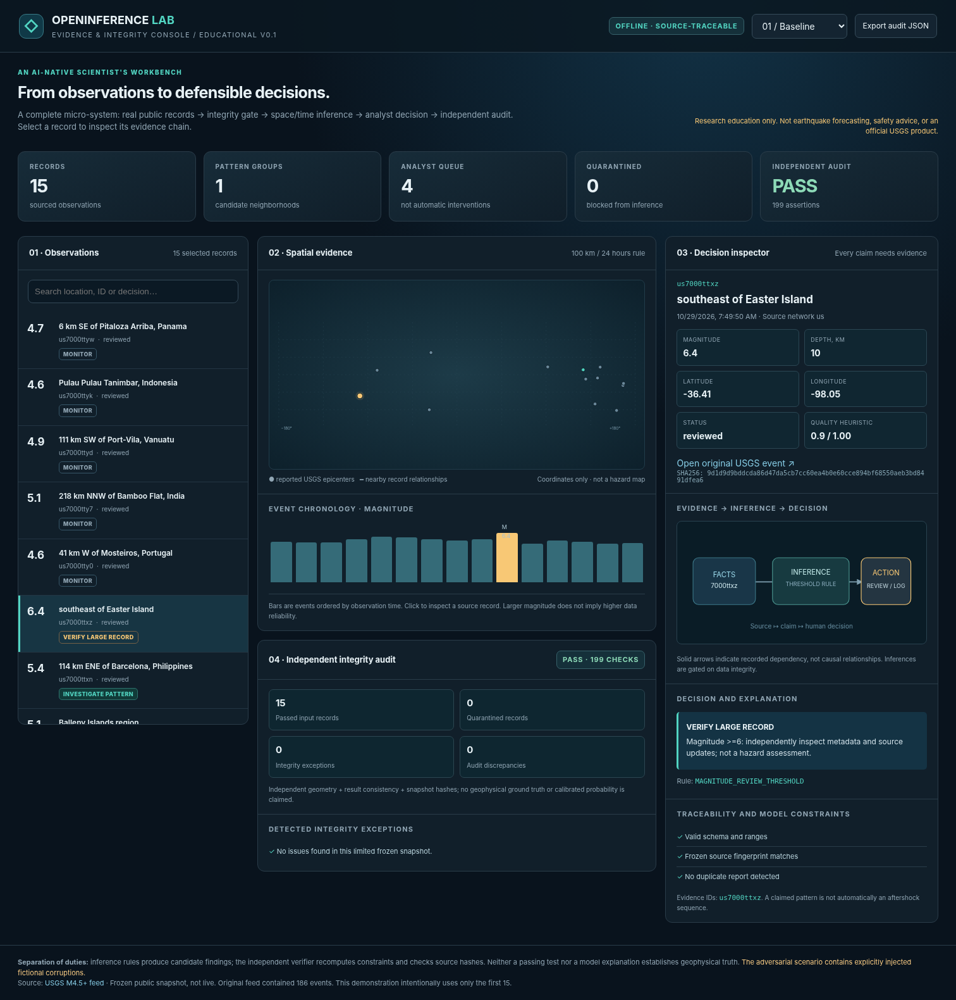
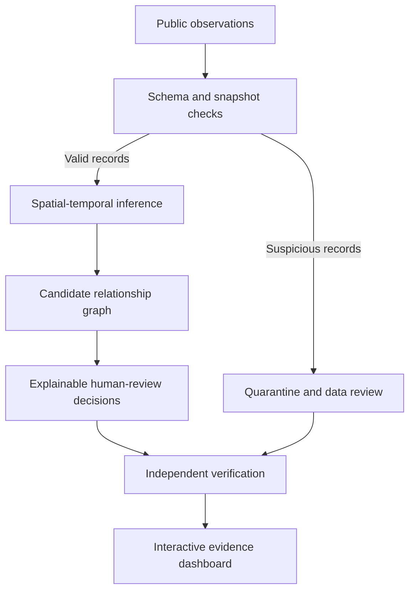

  

<h1 align="center">OpenInference Lab</h1>

  <strong>Build an inference system. Challenge its evidence. Verify its decisions.</strong> 
  A hands-on laboratory in AI-native data science and trustworthy computational reasoning.

  <a href="book/AI-Native-Data-Scientist.pdf">Read the companion booklet</a> ·
  <a href="STUDENT_LAB.md">Follow the learning lab</a> ·
  <a href="reports/index.html">Explore the dashboard source</a>

Why this project exists
AI coding assistants can now implement substantial software remarkably quickly. That changes the work of the data scientist and engineer: producing code is only part of the job; establishing what the code's conclusions mean, and whether they can be trusted, is the harder part.

OpenInference Lab is a small, inspectable example of that process. It takes public observations, validates their integrity, constructs explicit relationships, recommends items for human review, and independently checks the results. A visual dashboard exposes the evidence behind each recommendation. Deliberately damaged input demonstrates how a plausible-looking answer can go wrong.

The goal is to learn a repeatable engineering discipline:

Observe → Validate → Infer → Decide → Verify → Explain → Revise

No machine-learning or AI API is required to run the core example. AI is an optional collaborator in building, reviewing, and challenging the system—not the source of truth.
See it in action

  

The dashboard lets you inspect a record's source information, inferred links, decision, and audit trail, then switch between a clean dataset and a deliberately compromised one.
A reproducible experiment
The included dataset is a frozen 15-record selection from the public USGS earthquake feed. It is deliberately small, static, and not representative; it is used to study inference and verification, not seismology or earthquake forecasting.
Scenario	Input records	Quarantined	Candidate groups	Independent audit
Baseline	15	0	1	PASS
Deliberately compromised	16	5	1	PASS

The compromised scenario introduces three corrupted records and one fabricated record. A possible-duplicate finding causes an additional original record to be quarantined. An audit PASS means the implemented invariants hold for the report; it does not certify the scientific truth of every observation.
Quick start
Requirements: Python 3.10 or newer. The baseline application uses only the Python standard library—no installation of packages, credentials, or running server is needed.
# From the repository root
python -m openinference.demo
python -m unittest discover -s tests -v
Open reports/index.html in your browser. Choose Baseline or Adversarial to compare the two scenarios. The generated dashboard is a standalone HTML file.

The repository includes 20 automated tests. You can also use make demo and make test if Make is installed.
How the inference pipeline works

The implementation deliberately separates facts from interpretation:
1. Validate observations. Check coordinates, timestamps, source-field consistency, duplicate reports, and SHA-256 hashes against a frozen manifest. A hash protects consistency relative to that manifest; it is not proof that the source was authentic.
2. Infer relationships. Link two accepted events when they occur within 100 km and 24 hours. The resulting graph identifies candidates for investigation, not causal relationships.
3. Make review decisions. Assign CHECK_DATA, INVESTIGATE_PATTERN, VERIFY_LARGE_RECORD, or MONITOR using explicit, inspectable rules. These are workflow labels, not earthquake-risk classifications.
4. Verify independently. A separate module recomputes distances using a different formula, looks for unsupported and missing links, checks source-result consistency and evidence references, and tests decision rules.
5. Make the reasoning visible. Explore the source facts, inferred links, timestamps, explanations, and failed integrity checks in the browser dashboard.
Key files:
Path	Purpose
data/usgs_snapshot.json	Frozen public-data sample
data/source_manifest.json	Baseline hashes and source metadata
openinference/core.py	Validation, graph construction, and decision rules
openinference/verify.py	Independent result and structured-claim auditing
openinference/demo.py	Clean/adversarial runs and report generation
openinference/ui.py	Standalone evidence dashboard
openinference/llm.py	Optional LLM reviewer and factual-claim checks
tests/test_lab.py	Regression and integrity tests

Companion booklet
The AI-Native Data Scientist: Building, Testing, and Trusting Inference Systems
Mirco A. Mannucci · 37 pages · October 2026

[Read the illustrated booklet (PDF)](book/AI-Native-Data-Scientist.pdf) · [LaTeX manuscript](book/main.tex) · [Six-session student lab](STUDENT_LAB.md)

The booklet and code are meant to be studied together. Instead of presenting AI as a shortcut around mathematics or scientific reasoning, the book develops the skills needed to direct AI-assisted work and detect its failures:
- Evidence and uncertainty: what is observed, inferred, assumed, or unknown.
- Data integrity and provenance: invalid values, duplicates, tampering, lineage, and source limitations.
- Graph inference and decisions: proximity rules, connected components, decision policies, and the difference between association and causation.
- Independent verification: separate correctness oracles, adversarial cases, missing links, and the limits of passing tests.
- AI-native workflows: delegate implementation and candidate critiques to AI while independently checking factual claims.
- Visualization and changing evidence: make reasoning inspectable and understand what must be reconsidered when observations change.
Each chapter connects theory to executable experiments. The final assignment is to audit and improve the inference system, not merely get its code running.

To rebuild the PDF, install XeLaTeX and the TeX Gyre fonts, then run:
make book
Work with an AI reviewer (optional)
Generate a review prompt locally, without contacting an AI provider:
python -m openinference.llm --id us7000ttw3
To request a live review from Claude, set ANTHROPIC_API_KEY and ANTHROPIC_MODEL in your environment and run:
python -m openinference.llm --id us7000ttw3 --call-claude
This step is opt-in, requires provider access, and may incur charges. The reviewer returns structured claims; the code checks their referenced IDs and factual values. It cannot mechanically prove an unrestricted natural-language explanation. Never commit API keys.
Further experiments
The lab is intended to be modified. Try changing the proximity thresholds, adding uncertain or contradictory records, deleting an expected graph edge, or changing a decision after the fact. Predict what should happen before rerunning the independent tests. See [`STUDENT_LAB.md`](STUDENT_LAB.md) and [`prompts/ai_workflow.md`](prompts/ai_workflow.md) for guided tasks and AI-assistance protocols.

For a fresh USGS download (requires internet access):
python -m openinference.demo --fetch-live
This writes reports/live_download.json. It does not replace the frozen benchmark or validate the new records against the original manifest.
Data sources, scope, and limitations
The example uses public USGS GeoJSON earthquake data, documented in the USGS feed specification. See also USGS data-licensing guidance.

This is an educational software laboratory, not a USGS product, earthquake forecasting tool, or public-safety decision service. Its relationship rules are illustrative, the sample is too small to support statistical generalizations, and the evidence-quality indicators are heuristic—not calibrated probabilities. Independent code checks can find implementation inconsistencies, but establishing scientific validity also requires external ground truth and domain review.

License: A redistribution license for the repository's original code and booklet has not yet been selected. Do not assume reuse permissions from the repository's visibility; the underlying USGS data is governed by its own terms.
